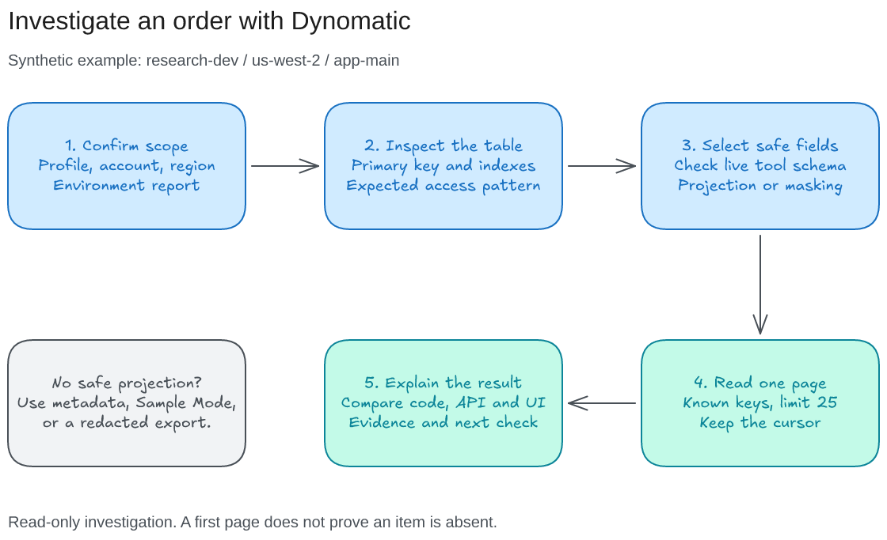

# thisguyskills

Skills for Claude Code and Codex that I use to research projects, investigate bugs, plan features, and prepare PRs. They work with local repos and the tools I already use: GitHub, Linear, Notion, Drive, Slack, AWS, Yaak, and [Dynomatic](https://app.dynomatic.io/).

Start with the skill that matches the task. Combine skills when the work needs more context.

- [Choose a skill](#choose-a-skill)
- [Install](#install)
- [Try a workflow](#try-a-workflow)
- [Set up your tools](#set-up-your-tools)
- [Use Dynomatic for DynamoDB questions](#use-dynomatic-for-dynamodb-questions)
- [Run Excalidraw](#run-excalidraw)
- [Check the repo](#check-the-repo)

## Choose a skill

| You want to... | Skill | What you get |
|---|---|---|
| Understand a project or research a feature | [project-research](project-research/SKILL.md) | An HTML brief with code evidence, flows, examples, tradeoffs, and next steps |
| Collect context across tools | [gather-context](gather-context/SKILL.md) | Sources from repos, GitHub, Linear, Notion, Drive, Slack, and available MCPs |
| Turn research into something readable | [plan-artifact](plan-artifact/SKILL.md) | Standalone HTML with offline diagrams, source links, and expandable detail |
| Resolve questions about one feature | [feature-plan](feature-plan/SKILL.md) | Answers grounded in the ticket and repos, with current and proposed diagrams |
| Explain architecture, costs, or operations | [architecture-report](architecture-report/SKILL.md) | A report at the levels your audience needs, from system context to code and data |
| Take an idea through implementation to a PR | [idea-to-pr](idea-to-pr/SKILL.md) | Discovery questions, a brief, scoped changes, verification, security review, and a PR |
| Recover a previous decision | [session-history](session-history/SKILL.md) | Bounded searches of local Claude Code or Codex history |
| Investigate AWS events, logs, or costs | [cloud-investigate](cloud-investigate/SKILL.md) | Evidence from native AWS CLI commands, Vantage, and available telemetry |
| Save or recall research in Martin's Brain | [notion-brain](notion-brain/SKILL.md) | One organized Notion record, or context for the next investigation |
| Query an endpoint already saved in Yaak | [yaak-query](yaak-query/SKILL.md) | A response tied to the intended request and environment |
| Inspect DynamoDB through Dynomatic | [dynomatic-query](dynomatic-query/SKILL.md) | Bounded, read-only evidence about tables, keys, and item state |
| Review a diff or service for security issues | [security-scan](security-scan/SKILL.md) | Findings confirmed against code, with impact and suggested fixes |
| Create, update, or rewrite a PR | [pr-automation](pr-automation/SKILL.md) | A concise description, actual validation, and a diagram when useful |
| Draw a diagram and review annotations | [excalidraw](excalidraw/SKILL.md) | An editable local canvas: draw -> annotate -> revise |
| Draw with multiple agents | [excalidraw-lanes](excalidraw-lanes/SKILL.md) | Optional canvas lanes when you explicitly request parallel drawing |

Research stops at an explanation or plan. Ask explicitly to save to Notion, create issues, or deliver a PR. Invoking `idea-to-pr` to deliver a PR covers its scoped implementation, commit, push, and PR workflow; merging and deployment need their own request. A local preview or description edit keeps that narrower scope.

## Install

From this checkout, including local changes:

```bash
npx skills@latest add . -a claude-code codex --skill idea-to-pr architecture-report feature-plan project-research gather-context plan-artifact session-history cloud-investigate notion-brain yaak-query dynomatic-query security-scan pr-automation excalidraw
```

Add `-g` for a global install. To install the published GitHub version:

```bash
npx skills@latest add thisguymartin/skills -g -a claude-code codex --skill idea-to-pr architecture-report feature-plan project-research gather-context plan-artifact session-history cloud-investigate notion-brain yaak-query dynomatic-query security-scan pr-automation excalidraw
```

For one skill, use its folder name with `--skill`:

```bash
npx skills@latest add . -a claude-code codex --skill dynomatic-query
```

Use `skills@latest` in this checkout. The local npm package is also named `skills`, so plain `npx skills` can resolve to this package and fail with `could not determine executable to run`.

Installation adds instructions and bundled helpers. It does not configure MCP servers or remove older skills. Add `--skill excalidraw-lanes` if you need the optional companion. Humanizer is an external skill and must already be installed for `idea-to-pr` delivery.

## Try a workflow

These prompts are examples. Replace paths, issue IDs, and resource names with your own. Database examples use synthetic identifiers.

### Understand a service before changing it

```text
Use project-research on apps/worker. Follow an order update from the API
through the queue to DynamoDB. Explain retries and failure cases, show
which files own each step, and make an HTML brief for a new teammate.
```

Use `architecture-report` when you need several levels of detail, operating costs, or an explanation for a particular audience:

```text
Use architecture-report to explain the ordering flow across the frontend
and worker repos. I need system context, data ownership, and operations.
Include queue failure handling and the evidence available for AWS costs.
```

The [architecture levels](architecture-report/altitudes.md), [source guide](architecture-report/sources.md), and [report template](architecture-report/report-template.md) describe that report. Its read-only scanner inventories tracked files without running project code and reads environment variable names only:

```bash
node architecture-report/scripts/scan-project.ts --root . --app apps/web --out /tmp/scan-web.json
```

### Plan a feature across repos

```text
Use feature-plan for this saved-cart issue across the frontend and API
repos. Should a cart belong to a user or a property? What changes after
checkout? Check existing branches, explain the current data model, and
draw the proposed flow in Excalidraw. Plan only.
```

`feature-plan` follows the ticket trail, reads the affected repos, and answers each question with evidence and a confidence. One diagram spec produces page SVGs and editable `.excalidraw` files. It can also append diagrams to a running canvas while preserving annotations.

```bash
node feature-plan/scripts/diagrams.ts --spec feature-plan/examples/saved-carts.json --out /tmp/diagrams --no-canvas
```

Use a new output directory for each revision. See the [diagram format](feature-plan/diagram-format.md).

### Take an idea through to a PR

```text
Use idea-to-pr with JBT-626 and JBT-627 across the frontend and Biggie.
Ask me about the behavior and edge cases. Trace both repos and create a
detailed brief with scoped frontend/backend work, acceptance criteria,
and verification. Then implement and open the PRs.
```

The workflow asks discovery questions, investigates the full path, and runs `security-scan` before delivery. It uses `pr-automation` and an installed Humanizer for final descriptions. Separate repos get scoped, linked PRs. To stop earlier, say "plan only" or "only draft the scoped issues". See the [interview guide](idea-to-pr/interview.md) and [working templates](idea-to-pr/templates.md).

For an existing change:

```text
Use pr-automation to create or update this PR. Base: develop.
Reviewers: alice. Diagram: auto. Keep it short.
```

Use `diagram: always` to request a diagram or `diagram: off` to skip it. Description edits do not commit or push. See the [description examples](pr-automation/description.md) and [diagram workflow](pr-automation/diagrams.md). Excalidraw is the first diagram option; the [mer-inkdrop](https://github.com/thisguymartin/mer-inkdrop) backup sends diagram source to mermaid.ink, so use sanitized source.

### Gather evidence and keep the decision

```text
Use gather-context to collect the issue, related PRs, and the relevant
Slack discussion about worker retries. Read the original sources and
call out anything that disagrees. Then use plan-artifact for an HTML plan.
```

```text
Save this research and its artifact to Martin's Brain as one record.
Include the decision, supporting evidence, and unresolved questions.
```

Saving needs a connected Notion tool with write access. For recall, ask to "pull prior context from Martin's Brain before planning". A preview stays local. Existing artifact builders and `artifact-upload` work alongside these skills when available and sharing is requested.

The bundled helpers also work directly:

```bash
node gather-context/scripts/github-evidence.ts --repo owner/repo --pr 123 --dry-run
node session-history/scripts/search-history.ts --provider claude --query "research artifact" --limit 10
node plan-artifact/scripts/render-brief.ts --input plan-artifact/examples/research-brief.json --output /tmp/research-brief.html
```

Edit the [synthetic brief](plan-artifact/examples/research-brief.json) before rendering your own. The renderer refuses to overwrite files. History searches default to bounded user prompts; full user/assistant text requires an exact session ID. They read local history, not claude.ai web conversations.

## Set up your tools

Install only what your task needs. The bundled runtime helpers use Node's built-in modules and require Node 22.18+. Repository validation also uses the development dependency `yaml`. Keep your existing Node version manager. See [Node's native TypeScript support](https://nodejs.org/en/learn/typescript/run-natively).

| Task | Requirements |
|---|---|
| Repo research and planning | A checkout or accessible sources; Node for bundled scanners/renderers |
| GitHub evidence and PR delivery | `git` and authenticated `gh`; repository checks for implementation |
| Cross-tool context | Connected tools for the sources you want to read; missing access is recorded |
| AWS investigation | AWS CLI v2 and an authenticated profile; Vantage for cost evidence when connected |
| Saved API requests | Yaak desktop collection and `@yaakapp/cli` |
| DynamoDB investigation | Dynomatic desktop app with MCP enabled; AWS access or Sample Mode |
| Editable diagrams | Node and the [yctimlin Excalidraw MCP](https://github.com/yctimlin/mcp_excalidraw); bundled inbox for annotation diffs |
| Notion saves | Connected Notion tools with page-write access; attachment tools for local files |
| Idea-to-PR delivery | `security-scan`, `pr-automation`, an installed Humanizer, and the target repo's tooling |

On macOS with Homebrew:

```bash
brew install awscli gh node ripgrep
aws --version
node --version
rg --version
gh auth login
gh auth status
```

Homebrew is a convenience. AWS maintains its own [CLI v2 installers](https://docs.aws.amazon.com/cli/latest/userguide/getting-started-install.html); GitHub CLI has an [installation guide](https://cli.github.com/) for other systems.

### AWS profiles

Reuse your organization profile when one is configured. For IAM Identity Center:

```bash
aws configure sso --profile research-dev
aws sso login --profile research-dev
aws sts get-caller-identity --profile research-dev
```

Check the returned account before resource reads. Keep access keys out of prompts and files. See [AWS SSO setup](https://docs.aws.amazon.com/cli/latest/userguide/cli-configure-sso.html).

`cloud-investigate` runs native `aws` commands. For example, ask it to trace why a worker stopped processing orders, using queue metadata and a bounded CloudWatch log window. The [AWS and cost guide](cloud-investigate/aws-and-costs.md) has commands and synthetic targets. Receiving an SQS message changes its visibility and receive count, so sampling messages needs a separate request. See [AWS receive behavior](https://docs.aws.amazon.com/cli/latest/reference/sqs/receive-message.html).

### Yaak

Install the [desktop app](https://yaak.app/docs/getting-started/installation), then its official CLI:

```bash
npm install -g @yaakapp/cli
yaak --version
yaak workspace list
```

```text
Use yaak-query to find the saved order-details request in my dev
workspace. Confirm the environment, send that request, and compare its
status field with the synthetic DynamoDB example we just inspected.
```

Use IDs returned by discovery and follow the [query commands](yaak-query/commands.md). Endpoint authentication comes from saved requests and environments; `yaak auth` is for plugin publishing. Avoid sending a whole workspace, which may run unrelated mutations. Examples were checked with CLI 2026.8.1; use installed `--help` when versions differ. See the [Yaak CLI docs](https://yaak.app/docs/getting-started/cli-usage).

Yaak's `yaak agent install` is optional. It writes global skill directories and refreshes Yaak's own `use-yaak` skill; `yaak-query` is a separate research workflow. `jq` is optional for local JSON projections and redaction.

### Other connections and security review

Connect Linear, Notion, Drive, Slack, Vantage, and telemetry through your agent's normal connector setup. Research skills discover available tools and work with partial context. They do not install connectors or change credentials as a side effect.

`security-scan` is read-only and accepts a PR, diff, file, directory, or service. For example: "review this PR for tenant authorization gaps and browser data exposure." It traces code and reports confirmed findings with severity, OWASP category, impact, and a suggested fix. It loads its [backend](security-scan/backend.md) and [frontend](security-scan/frontend.md) guides as needed; dependency auditing is optional with `--audit`.

## Use Dynomatic for DynamoDB questions

We use [Dynomatic](https://app.dynomatic.io/), the desktop DynamoDB app, through its built-in MCP server. `dynomatic-query` investigates item state, table design, and disagreements between stored data and the UI. It stays read-only.

### Connect Dynomatic

1. Install and open Dynomatic.
2. Open Settings -> MCP Server and enable the server. Leave write permissions off for investigation.
3. In "Add Dynomatic to a client", select Claude Code or Codex and use the generated command or configuration. It includes the executable path for your installation.

For a standard macOS installation, the stdio bridge commands are:

```bash
claude mcp add dynomatic -- /Applications/Dynomatic.app/Contents/MacOS/dynomatic mcp
codex mcp add dynomatic -- /Applications/Dynomatic.app/Contents/MacOS/dynomatic mcp
```

Register the client you use. The bridge reads the app's endpoint and token, so you do not put a token in client configuration. It can connect while the app is closed; tools become available when Dynomatic is open with MCP enabled. It does not launch the app. See [Dynomatic's connection guide](https://app.dynomatic.io/docs/mcp/connect-a-client) and the local [setup and tool reference](dynomatic-query/tools.md).

### Start with a concrete question

```text
Use dynomatic-query in Sample Mode first. Check app_status and the
environment report, then list the available tables and describe one.
Explain its primary key and indexes without reading full item payloads.
```

For a development table with synthetic data:

```text
Use dynomatic-query to investigate why demo order 1042 still looks pending.
Profile: research-dev. Region: us-west-2. Table: app-main.
PK: ORG#demo-1. SK: ORDER#1042.

Confirm the account and environment, then inspect the key schema. Read
only the key, status, updatedAt, and version fields if a safe server-side
projection is supported. Compare the result with the worker's write path.
Report the evidence and next check; keep the investigation read-only.
```

The [worked examples](dynomatic-query/examples.md) cover missing orders in a list, single-table models, projected PartiQL reads, and opening a query for manual review. Each explains what to ask, what to check, and where the conclusion must stop.



[Open the editable Excalidraw diagram](docs/diagrams/dynomatic-investigation.excalidraw).

Real-data reads require projection or masking before the tool response reaches the model. If the tool cannot return a safe shape, use metadata, Sample Mode, or an already redacted export. Prefer known keys and queries; scans are a last resort. Keep a page limit and cursor. An empty page does not establish absence from the table. Full production scans and exports need an explicit request; writes are outside this skill.

## Run Excalidraw

Use [yctimlin/mcp_excalidraw](https://github.com/yctimlin/mcp_excalidraw). Its npm package provides the MCP server and a local editable canvas. Register it with your client:

```bash
claude mcp add excalidraw --scope user -- npx -y mcp-excalidraw-server@2.1.2
codex mcp add excalidraw -- npx -y mcp-excalidraw-server@2.1.2
```

Start the canvas and check its status:

```bash
npx -y mcp-excalidraw-server@2.1.2 start
npx -y mcp-excalidraw-server@2.1.2 status
```

Open [http://127.0.0.1:3000](http://127.0.0.1:3000) to watch or annotate. The MCP server can also start the canvas automatically. Screenshots and image exports run headlessly; Mermaid conversion and viewport changes need an open canvas tab.

```text
Use Excalidraw to draw the order investigation: confirm the environment,
inspect the table's keys and indexes, select safe fields, read one page,
then compare the result with the API and UI. Export an editable scene and
a PNG. Let me annotate the canvas before you revise it.
```

The [canvas setup guide](excalidraw/INSTALL.md) covers custom ports, per-session canvases, persistence, and the bundled `excalidraw-inbox` annotation workflow. Use the same canvas URL in the MCP and inbox. The standard frontend supports manual annotation; a Send to Claude button requires a customized frontend.

Export the scene before stopping the standard canvas; it is in memory by default:

```bash
npx -y mcp-excalidraw-server@2.1.2 export --out /tmp/order-flow.excalidraw
npx -y mcp-excalidraw-server@2.1.2 screenshot --out /tmp/order-flow.png
npx -y mcp-excalidraw-server@2.1.2 stop
```

## Check the repo

```bash
corepack pnpm install --frozen-lockfile
npm run check
npm test
```

Checks cover skill metadata and local links. Synthetic tests also cover artifact preservation, HTML escaping, diagram revisions and recovery, canvas startup/persistence, history filters, and GitHub CLI argument safety. Live integrations, PR delivery, and attachments need verification in their own environments; tests do not write to AWS, Vantage, Linear, Notion, Slack, or GitHub.

Source revisions and adaptations are recorded in [third-party notices](THIRD_PARTY_NOTICES.md). Original skills and scripts are [MIT](LICENSE). Notion and Yaak adaptations retain their notices; retained Excalidraw material has its source and license status documented separately.
